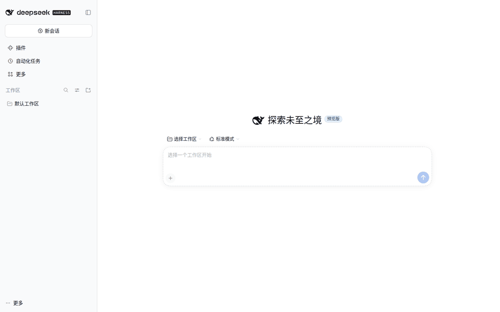

# dsh-agent-lines

English | [中文](README.md)

GitHub: [Lencen/dsh-agent-lines](https://github.com/Lencen/dsh-agent-lines)

> Community plugin for DeepSeek Harness. Not an official DeepSeek product.

> **100% Vibe Coding.** The architecture, code, tests, and docs were produced in AI agent sessions. It is experimental: review the code and run an integration test before production use.

A drop-in super-agent alternative for DSH.

Stop reopening sessions and copying context by hand. Give one lead agent a long-lived team: each member has a name and a role, messages survive restarts, and the lead collects and reports the results.

## When to use it

Use it when:

- You have a long-running project and do not want to re-explain the background every time.
- You want several agents to keep stable roles: research, architecture, UI/UX, development, testing, release, and operations.
- You need a fixed name for each role, so you can assign work directly.
- Work must survive closing a window or restarting DSH: messages and context should still be there.
- You want one lead agent to decompose work, create the team, track progress, collect results, and report back.


## Install

One-command install (recommended; no need to find a profile):

    curl -fsSL https://raw.githubusercontent.com/Lencen/dsh-agent-lines/main/install.sh -o install.sh
    bash install.sh

The script picks the DSH Web profile, installs the plugin, and verifies agent-lines. If it cannot decide, it lists existing profiles and tells you how to specify one.

**Restart DSH Web after install or update.** A running process does not load new plugin code. With no plugin config the plugin starts in zero-config mode: one unbound manager line, and a root Session can call line_claim_manager to bind itself. The explicit "Manager config" block is optional, for a fixed manager/worker setup.

Offline or when npm is unavailable, use the local tarball:

    bash install.sh ./dsh-agent-lines-0.3.3.tgz

After install and restart, it works without a config. When you want a fixed manager/worker setup, paste the "Manager config" block below into the file printed by the installer.

### Manager config (optional)

```yaml
- id: agent-lines
  name: dsh-agent-lines
  config:
    agentId: agent-demo
    dbPath: /home/me/.dsh/agent-lines/lines.db
    allowCreate: true
    allowClaim: true
    allowSelfSend: false
    dedupeWindowMs: 5000
    maxReplyDepth: 8
    createFrom: manager-line
    maxLines: 16
    childPreset: standard
    lines:
      - label: manager-line
        sessionId: session-lines-manager
        role: 任务对接、拆解与调度
```

Only `createFrom` may call `line_create`. Worker profiles should leave `allowCreate` false.

## Quick start

1. Run the installer above.
2. **Restart DSH Web** so the plugin is loaded.
3. Open any root Session. The zero-config path needs no YAML.
4. Call line_status; if the Session is not bound, call line_claim_manager({ confirm: "bind-manager" }).
5. Say "create the first-use team"; wait for the member lines, then send the first task separately.

## First use: build a development team

Copy this into a new root Session. The prompt starts with binding, then creates one team. Replace the task later; do not let the manager execute the work.

> Use dsh-agent-lines. Make this Session the development team lead; bind it first if needed.
>
> You own task decomposition, assignment, coordination, progress tracking, result collection, and reporting. You manage and coordinate only; do not execute development tasks.
>
> Form the team. Use short English names and Chinese roles: research (调研), architecture (架构), uiux (UIUX), dev (开发), test (测试), acceptance (验收), release (发布), ops (运维).
>
> After the team is ready, wait for my first task. Do not start by yourself.

Member names are short English names; Chinese is the role. This prompt creates one team. Version 0.3 does not support multiple simultaneous teams in one plugin instance.

Copyable calls (the manager Session runs these):

~~~js
line_create({ label: "research", role: "调研" })
line_create({ label: "architecture", role: "架构" })
line_create({ label: "uiux", role: "UIUX" })
line_create({ label: "dev", role: "开发" })
line_create({ label: "test", role: "测试" })
line_create({ label: "acceptance", role: "验收" })
line_create({ label: "release", role: "发布" })
line_create({ label: "ops", role: "运维" })
~~~

After creation, call line_list to confirm.



Actual DSH Web demo profile, generic labels; no internal data.

## Scenario: one manager, several execution lines

The lead creates the team first; the work comes next.

1. The lead creates members by role: research, architecture, UI/UX, development, testing, acceptance, release, operations.
2. You give the lead one concrete task, for example "add CSV export to the reports page, with tests and a one-page runbook."
3. The lead decomposes it and sends each part to the right member; every message stays local.
4. Members receive the task, execute it, acknowledge it, and reply to the lead when needed.
5. The lead collects results, resolves disagreements, and aligns the answer.
6. You see the lead's summary; each member keeps its own context and message history.

This is a prompt-driven team pattern, not a built-in org chart: the lead model decides how to split work. Technical details are in "Use" and "Delivery semantics" below.

## Use

A manager can be driven entirely by conversation:

> You are the manager line. Create frontend-line, backend-line and ops-line with `line_create`, then list them with `line_list`.

Tools:

| Tool | Purpose |
|---|---|
| `line_status` | Read-only: current Session binding, manager Session live/persisted, lines, repair command; visible even when unbound |
| `line_claim_manager` | Bind this live root Session as manager; requires `allowClaim: true` and `confirm: "bind-manager"`; global, no shell needed |
| `line_list` | List lines, status, unread counts, current line and role |
| `line_create` | Manager only: create a DSH Session in the manager workspace (or a named existing workspace) and register it as a line; same label is idempotent |
| `line_move_workspace` | Manager only: attach an existing line Session to a workspace whose path exactly matches the Session cwd |
| `line_send` | Send to `line` or `agent#line`; optional `idempotencyKey`, `replyTo`, `noReply`, `forceDistinct`, `ttlMs` |
| `line_inbox` | Read delivered messages for the current line |
| `line_ack` | Acknowledge a delivered message |

Line tools other than `line_status` and `line_claim_manager` are registered only on Sessions bound to a line. Both control tools are global: `line_status` is read-only, and `line_claim_manager` is root-only and gated by `allowClaim`.

`line_create` creates an ordinary DSH Session in the manager workspace (or in the manager cwd when no workspace exists). It does **not** create a separate OS process, profile, or port; all lines in that call share the DSH process. It also does not transfer an existing Session.

Created lines are recorded with `created_by` and restored by the manager on process startup. line_create uses the manager's workspace (workspaceId, so DSH attaches the Session) when one exists; otherwise it falls back to the manager cwd and the line is ungrouped. Pass `workspace` (existing path or id) to create in another workspace. A line whose Session was never materialized may fail on first delivery with `session/not-found`; send it a task (or recreate it) to persist the Session.

CLI:

```bash
dsh-agent-lines list
dsh-agent-lines send --from frontend-line --to backend-line --text "hi"
dsh-agent-lines inbox --line backend-line
dsh-agent-lines ack --line backend-line --id msg_...
dsh-agent-lines claim --agent agent-demo --line manager --session "$DSH_SESSION_ID"
dsh-agent-lines doctor
```

Use `--db` or `DSH_AGENT_LINES_DB` to point the CLI at the plugin's database.

## Transports

`transport` defaults to `sqlite` (local-first) and is the only transport shipped in 0.3. Installing the plugin never requires Postgres or a Python service.

## Architecture

~~~mermaid
flowchart LR
  U[User] --> M[Manager DSH Session]
  M -->|line_create / line_send| P[dsh-agent-lines]
  P --> Q[(SQLite lines.db)]
  P -->|prompt requestId| W1[Worker line Session A]
  P -->|prompt requestId| W2[Worker line Session B]
  W1 -->|line_inbox / line_ack| P
  W2 -->|line_inbox / line_ack| P
~~~

The DSH adapter owns line identity and delivery into a Session; the transport owns durable messages and cross-process storage. The default transport is local SQLite. Public architecture: [English](docs/ARCHITECTURE.en.md) | [中文](docs/ARCHITECTURE.md).

## Requirements

- DSH `>=0.2.1-rc.5 <0.3.0`
- Node.js `^22.19.0 || >=24.0.0`
- A local filesystem for the SQLite database (NFS/CIFS/SMB/FUSE are refused)

## Workspaces

DSH groups Sessions by workspace membership, not by cwd. line_create resolves the
manager's workspace with workspaceRegistry.resolveByPath and passes workspaceId,
so the new Session is attached and appears under that workspace instead of
"Ungrouped". If the manager has no workspace, the plugin falls back to cwd; the
line remains ungrouped until a workspace is created/attached.

line_move_workspace attaches an existing line to a target workspace. DSH itself
only allows attachment when the Session cwd exactly equals the workspace path;
the plugin returns WORKSPACE_ATTACH_FAILED otherwise. It does not move a Session
between different directories (that would require a new Session/handover).

## Manager binding and claim

The manager line is a real DSH Session. If you open a different Session, it is not the manager and the line tools are intentionally absent. Use `line_status` to see the configured manager and repair instructions.

A root Session can bind itself without a shell:

```json
line_claim_manager({ "confirm": "bind-manager" })
```

The tool validates that the caller is a live root, releases the old manager lease, rebinds the manager line, and persists the choice in `manager_bindings`. No profile edit or restart is needed. It requires `allowClaim: true`.

An operator can still use the CLI:

```bash
dsh-agent-lines claim --agent agent-demo --line manager --session "$DSH_SESSION_ID"
```

Claim is never automatic for every new Session: it needs an explicit user request or an explicit CLI call.

## Echo and duplicate protection

- Same `idempotencyKey` returns the existing message.
- Without a key, identical sends within `dedupeWindowMs` (default 5s) collapse to one; use `forceDistinct: true` for two intentional identical messages.
- `replyTo` increments `hop`; over `maxReplyDepth` (default 8) is rejected with `LINE_REPLY_DEPTH_EXCEEDED`.
- A `noReply: true` message cannot be replied to; attempts fail with `LINE_NO_REPLY`.
- Self-send is rejected by default (`LINE_SELF_SEND_FORBIDDEN`); set `allowSelfSend: true` only for deliberate notes.

This is transport-level protection. It does not guarantee that two agents will not choose to keep chatting; use `noReply` and reply depth for that.

## Delivery semantics

`queued → claimed → delivered → acked`

- `delivered` means the target DSH Session accepted the prompt.
- `acked` means an agent explicitly called `line_ack`.
- Delivery is **at-least-once**; DSH's `requestId` idempotency makes retries effectively-once in the Session log. It is not a distributed exactly-once guarantee.
- An offline receiver keeps messages queued; 0.3 has no automatic process wake.
- **One Session, one writer.** Do not open a line's Session in another DSH process (for example the main Web UI). DSH rejects delivery with `session/writer-held`; close the other view or use a dedicated Session.

## Security

- The plugin runs in the DSH Host process with host permissions. Install only packages you trust.
- Default transport is local SQLite; no network listener in 0.3.
- Only the configured manager line can create lines; `maxLines` bounds growth.
- Peer messages are marked as peer content, not user instructions.
- See [docs/SECURITY.en.md](docs/SECURITY.en.md).

## Limitations

- No handover; no move of a Session between different directories.
- Same-process multi-line, not process isolation.
- One manager/team per plugin instance. Simultaneous teams (for example development and novel) in one DSH process are not supported; separate profile/DB is only a workaround, not the product model.
- No `line_delete`; a created line is durable, so testing creates real rows.
- A blank line Session may need its first task before it is persisted.
- DSH allows one writer per Session; do not open a line Session from another DSH process.

## Status

Experimental `0.3.x`. DSH is in developer preview and its APIs can change. Pin both the DSH version and this plugin's version.

## Credits

- Human vibecoding: **Lencen**
- Development agent: **DeepSeek Harness agent (DSH)**
- Model: **deepseek v4.1 flash 1017**
- Contact: [iamlencen@qq.com](mailto:iamlencen@qq.com)

## Contributing

See [CONTRIBUTING.en.md](CONTRIBUTING.en.md); code of conduct [CODE_OF_CONDUCT.en.md](CODE_OF_CONDUCT.en.md); docs site [lencen.github.io/dsh-agent-lines](https://lencen.github.io/dsh-agent-lines/).

## License

Apache-2.0. See [LICENSE](LICENSE).
