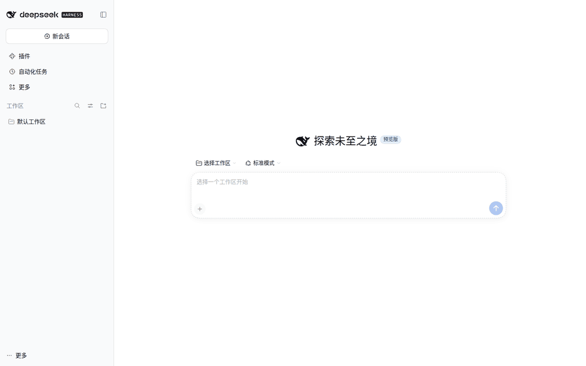

# dsh-agent-lines

[English](README.en.md) | 中文

GitHub: [Lencen/dsh-agent-lines](https://github.com/Lencen/dsh-agent-lines)

> DeepSeek Harness 社区插件，不是 DeepSeek 官方产品。

> **100% Vibe Coding。** 架构、代码、测试、文档都在 AI agent 会话中完成。它是实验性项目：生产使用前请审阅代码并跑一遍集成测试。

DSH 的 super agent 平替插件。

你不用每次新开会话、手动把背景复制给几个 agent。让一个负责人 agent 带一支长期协作的团队：每个成员有名字、各负责一块，任务和消息不会丢，结果由负责人汇总给你。

## 什么时候用

如果你遇到这些情况，再考虑安装：

- 你有一个长期项目，不想每次都从头解释背景；
- 你希望几个 agent 长期分工，比如调研、架构、开发、测试、发布、运维；
- 你需要给每个角色一个固定名字，能直接点名派任务；
- 任务做到一半关掉窗口、重启 DSH，消息和上下文还要在；
- 你希望一个负责人 agent 自己拆任务、建团队、追进度、收结果，最后向你汇报。


## 和官方 Agent Teams 的区别

不是替代关系，是互补关系。一句话：**官方 Agent Teams 管“事”，dsh-agent-lines 管“人”和“消息”。**

| 维度 | 官方 Agent Teams | dsh-agent-lines |
|---|---|---|
| 定位 | 任务编排、团队协作 | 长期角色、持久通信 |
| 角色 | 具名 teammate，围绕任务协作，进程内生命周期 | 线长期存在，跨会话、跨重启 |
| 任务 | 共享任务板、任务 DAG、blocked_by、Web 面板 | 没有任务板；负责把任务/消息可靠送到角色 |
| 消息 | 直接 inbox，当前团队协作；不保证重启后重试 | SQLite 持久队列，lease、ack、重试、断线续投 |
| 上下文满了 | 新建 teammate | handoff + replace，同一角色换新 Session |
| 工作目录 | 成员共享工作区 | 每条线可以绑自己的 workspace |
| 适合 | 一次性/短周期多 agent 编排 | 长篇小说、系列视频、长期研究、持续运营 |

**一起用：** line 管人，team 管事，文件管记忆。用户只给 manager 发任务；manager 自动读 Agent Teams 任务和 line 状态，不要求用户导出或配置。

官方 Agent Teams 目前是 experimental；dsh-agent-lines 是社区插件，不是 DeepSeek 官方产品。

## 与官方 Agent Teams 融合（只读，0.5.0）

用户只给 manager 发任务。manager 自动读官方 Agent Teams 任务和成员，按 teammate name 自动映射 line；不要求用户导出任务、不要求配置映射、不要求点插件按钮。

前提：manager line 必须同时是 Agent Teams Lead 或成员；否则显示不可用，不降级到用户导出。

只读：不写任务、不写 lines.db、不触发管理线 turn；L2 双向未批准。

详见 [docs/AGENT-TEAMS.md](docs/AGENT-TEAMS.md)。

## 团队类型不限于开发

插件不限定团队类型。本质是“一个负责人 + 若干长期成员”的协作方式。
下面用开发团队做示例；小说、视频、研究、运营团队只换角色和任务，不需要改插件或代码。

- 小说：总编、大纲、写手、编辑、校对、审读；
- 视频：负责人、策划、脚本、剪辑、封面、发布；
- 开发：负责人、开发、测试、验收；
- 研究：负责人、资料、分析、写作、审阅。

第一次不需要自己想清楚角色：直接对负责人说“帮我建个小说创作团队，按小说创作的流程建立工作流程与机制”，它会先给团队结构和流程建议，你确认或补充即可。

## 版本能力与业务场景

### 0.3.6：上下文满了，角色可以换人

场景：写手线连续工作很久，上下文配额耗尽；继续写容易出现前后矛盾。  
用法：管理线调用 line_create({ label: "writer", replace: true, force: true, reason: "context full" })。  
效果：同一个 label 切到干净 Session，旧 Session 只 retired、不删除；queued/claimed 消息迁移，delivered/acked 不重投；管理线不需要手工改路由。

### 0.3.7：换人之前先交接

场景：新写手不知道旧线做到哪、下一步是什么、哪些坑不能踩。  
用法：line_handoff({ line: "writer", format: "md" })。  
效果：生成结构化交接单（进度、积压、最近消息、生命周期），不调用模型；新线先读交接单再继续。

### 0.3.8：什么时候该换线

场景：管理线想知道哪条线快满了、哪条线最近没动静。  
用法：line_status / line_list 看 activity.level、turns、steps、lastActivityAt。  
效果：给出低/中/高活跃度，不伪造“上下文使用率 78%”；真实窗口等 DSH 上游提供。

### 0.4.1：管理线看得到跨线消息

场景：成员线之间直接同步，管理线需要知道发生了什么，但不希望每条消息都打断自己。  
用法：line_observe({ line: "writer", limit: 20 }) 或 CLI observe --json。  
效果：只读 feed，显示 from/to/state/摘要；不注入 prompt、不改消息状态；line_send 语义不变。

## 安装

### 让 DSH 帮你装（推荐给新手）

在 DSH 新会话里说：

~~~text
帮我检查并安装 GitHub 上 Lencen/dsh-agent-lines 插件。
只从官方仓库或官方 npm 安装，不要从其他 fork 安装。
安装前先告诉我准备执行什么命令，等我确认后再执行。
安装完成后按插件要求加载；如果需要重启 DSH Web，先告诉我重启后打开哪个地址、
怎么新开会话、第一句该说什么，并提醒当前会话会断开；等我确认后再重启。
~~~

重启后当前会话会断开，agent 无法再自动通知你；重启后的步骤会在重启前给你。

### 手动安装

一条命令安装（推荐，不需要自己找 profile）：

    curl -fsSL https://raw.githubusercontent.com/Lencen/dsh-agent-lines/main/install.sh -o install.sh
    bash install.sh

脚本会自动选择 DSH Web 使用的 profile，安装后检查 agent-lines 是否可用；如果判断不了，会列出已有配置并提示你怎么指定。

**安装或更新后必须重启 DSH Web。** 运行中的进程不会加载新插件代码。插件没有 config 时走零配置：启动一条未绑定 manager，根会话可以调用 line_claim_manager 自己绑定。显式“管理线配置”是可选的，用于固定 manager/worker。

离线或 npm 不可用时，用本地 tarball：

    bash install.sh ./dsh-agent-lines-0.4.1.tgz

安装并重启后，不写配置也可以直接使用；需要固定管理线/worker 时，再把下面“管理线配置”粘贴到脚本打印的配置文件。

### 管理线配置（可选）

```yaml
- id: agent-lines
  name: dsh-agent-lines
  config:
    agentId: agent-demo
    dbPath: /home/me/.dsh/agent-lines/lines.db
    allowCreate: true
    allowClaim: true
    allowSelfSend: false
    dedupeWindowMs: 5000
    maxReplyDepth: 8
    createFrom: manager-line
    maxLines: 16
    childPreset: standard
    lines:
      - label: manager-line
        sessionId: session-lines-manager
        role: 任务对接、拆解与调度
```

只有 `createFrom` 指定的线能调用 `line_create`。worker profile 不要开 `allowCreate`。

### 新线 bootstrap

管理线调用 line_create 创建新线时，插件默认排队一条不要求执行任务的 onboarding 消息，让空白 Session 产生第一条消息并出现在侧栏；传 bootstrap: false 可关闭。

line_status / line_list 会返回 materialized、visibleInSidebar、bootstrapQueued；新线在首条消息前可能仍是 blank。

## 快速开始

1. 运行上面的安装脚本。
2. **重启 DSH Web**，让插件加载。
3. 打开任意根会话。零配置路径不需要改 YAML。
4. 先调用 line_status；如果当前会话未绑定，调用 line_claim_manager({ confirm: "bind-manager" })。
5. 直接说“按首次使用创建团队”，然后等它建好成员线；第一个任务再单独发。

## 首次使用：组建开发团队

在新根会话里直接复制下面这段。它会先绑定管理线，再创建一支团队；后续任务再单独发，不要让它自己开工。

> 使用 dsh-agent-lines。先把这个会话设为开发团队的管理线；如果还没绑定，就先完成绑定。
>
> 你是开发团队负责人：负责任务拆解与分配、协调沟通、跟踪进度、汇总结果、总结汇报。你只做管理和协调，不执行具体开发任务。
>
> 请组建开发团队。成员名字用简短英文，岗位用中文：research（调研）、architecture（架构）、uiux（UIUX）、dev（开发）、test（测试）、acceptance（验收）、release（发布）、ops（运维）。
>
> 团队建好后先待命，不要自动开工，等我发第一个任务。

成员名字用英文短名，中文放在岗位上。这个提示词只创建一个团队；0.3 不支持同一插件实例同时多个团队。

可直接复制的调用（由管理线 Session 执行）：

~~~js
line_create({ label: "research", role: "调研" })
line_create({ label: "architecture", role: "架构" })
line_create({ label: "uiux", role: "UIUX" })
line_create({ label: "dev", role: "开发" })
line_create({ label: "test", role: "测试" })
line_create({ label: "acceptance", role: "验收" })
line_create({ label: "release", role: "发布" })
line_create({ label: "ops", role: "运维" })
~~~

创建后用 line_list 确认。



真实 DSH Web 演示 profile、通用 label；不含内部数据。

## 场景：一个管理线 + 多条执行线

负责人先建好团队，后面才是具体任务。

1. 负责人按角色建立成员：调研、架构、UIUX、开发、测试、验收、发布、运维。
2. 你给负责人一个具体任务，例如“给报表页加 CSV 导出，带测试和一页 runbook”。
3. 负责人把任务拆开，派给对应的成员；每条消息都会留在本地。
4. 成员收到任务、执行、确认收到，需要时回复负责人。
5. 负责人收集结果，处理成员之间的分歧，统一口径。
6. 你看到负责人的汇总；每个成员保留自己的上下文和消息记录。

这只是“用提示词组织团队”的方式，不是插件内置的组织架构；怎么拆任务由负责人模型决定。技术细节（消息、状态、工具）在下面的“使用”和“投递语义”。

## 上下文活跃度

line_status / line_list 返回 activity：turns/steps/decodeTokens/level/lastActivityAt。
level 是活跃度代理（low/medium/high），不是上下文使用率百分比；DSH 当前不暴露上下文窗口。

## 使用

管理线可以完全由对话驱动：

> 你是管理线。用 `line_create` 创建 frontend-line、backend-line、ops-line，然后用 `line_list` 确认。

工具：

| 工具 | 作用 |
|---|---|
| `line_status` | 只读：当前会话绑定、manager Session 是否存在/live、线列表、修复命令；未绑定也可见；含 activity 活跃度（不是 contextUsage） |
| `line_claim_manager` | 把当前 live 根 Session 绑成 manager；需要 `allowClaim: true` 和 `confirm: "bind-manager"`；全局工具，不需要 shell |
| `line_list` | 列出线、状态、未读数、当前线和 role |
| `line_create` | 仅管理线：创建新线；同 label 幂等；传 replace:true 可给同 label 换新 Session |
| `line_handoff` | 仅管理线：生成结构化交接单（JSON/Markdown），不调模型 |
| `line_observe` | 仅管理线：只读跨线消息 feed；显示 kind/审批状态，不注入 prompt、不改状态 |
| `line_manager_ack` | 仅管理线：对 pending_approval 的 task 做 approve/reject |
| `line_team_board` | 仅管理线：只读融合看板；自动读 Agent Teams 任务/成员 + lines，无用户导出/配置 |
| `line_retire` | 仅管理线：软下线；拒绝新发送，保留 Session/历史 |
| `line_rebind` | 仅管理线：把线原子切到新的 live Session，可迁移积压 |
| `line_rename` | 仅管理线：改侧栏标题，持久化到 lines.db |
| `line_move_workspace` | 仅管理线：把已有线的 Session 挂到路径完全匹配的工作区 |
| `line_send` | 发到 `line` 或 `agent#line`；可选 `kind`、`ccManager`、`idempotencyKey`、`replyTo`、`noReply`、`forceDistinct`、`ttlMs` |
| `line_inbox` | 读当前线已投递消息 |
| `line_ack` | 确认已处理 |

除 `line_status`、`line_claim_manager` 外，line 工具只注册在已绑定线的 Session 上；这两个控制工具是全局的：status 只读，claim 仅限根会话且受 allowClaim 控制。

`line_create` 在管理线所属工作区（没有工作区时回退当前目录）创建普通 DSH Session；它**不会**创建独立 OS 进程、profile 或端口，也不转移已有 Session。

### 上下文满时换人

线不会自动继承旧 Session 的上下文。推荐流程：

1. 让旧线写交接单（0.3.7 起可用 `line_handoff`）；
2. 管理线调用 `line_create({ label, replace: true, force: true, reason: "context full" })`；
3. 插件创建干净 Session、同 label 原子切换，旧 Session 标记 retired 但保留；
4. queued/claimed 消息迁移到新线；delivered/acked 留在旧 Session，不重投。

`migrate: "none"` 时若还有 queued/claimed 会直接报 `LINE_BACKLOG_NOT_EMPTY`，不会静默切走。

创建的线会记录 `created_by`，进程重启时由管理线恢复。line_create 会解析管理线所属工作区并传 workspaceId（DSH 会自动 attach），所以新线出现在该工作区而不是“未分组”；如果管理线本身不在工作区，则回退 cwd，线保持未分组。传 `workspace`（已有路径或 id）可指定其他工作区。若某条线的 Session 还从未落盘，首次投递可能 `session/not-found`；给它发一条任务（或重新创建）即可让它持久化。

CLI：

```bash
dsh-agent-lines list
dsh-agent-lines send --from frontend-line --to backend-line --text "hi"
dsh-agent-lines inbox --line backend-line
dsh-agent-lines ack --line backend-line --id msg_...
dsh-agent-lines --json observe --line writer --limit 20
dsh-agent-lines claim --agent agent-demo --line manager --session "$DSH_SESSION_ID"
dsh-agent-lines doctor
```

用 `--db` 或 `DSH_AGENT_LINES_DB` 指向插件同一个数据库。

## 传输

`transport` 默认 `sqlite`（local-first），也是 0.3 唯一发布的 transport；安装插件不需要 Postgres 或 Python 服务。

## 架构

~~~mermaid
flowchart LR
  U[用户] --> M[管理线 DSH Session]
  M -->|line_create / line_send| P[dsh-agent-lines]
  P --> Q[(SQLite lines.db)]
  P -->|prompt requestId| W1[前端线 Session]
  P -->|prompt requestId| W2[后端线 Session]
  W1 -->|line_inbox / line_ack| P
  W2 -->|line_inbox / line_ack| P
~~~

DSH 适配层负责线身份和“把消息送进 Session”；transport 负责持久消息和跨进程存储。默认是本地 SQLite。公开架构说明：[English](docs/ARCHITECTURE.en.md) | [中文](docs/ARCHITECTURE.md)。

## 要求

- DSH `>=0.2.1-rc.5 <0.3.0`
- Node.js `^22.19.0 || >=24.0.0`
- 本地文件系统（NFS/CIFS/SMB/FUSE 会被拒绝）

## 工作区

DSH 侧边栏按 workspace 的 sessionIds 成员表分组，不是按 cwd。line_create 通过 workspaceRegistry.resolveByPath 找到管理线所属工作区，传 workspaceId，DSH 会在创建时 attachSession，新线就不会落到“未分组”。如果管理线没有 workspace，插件回退 cwd，线仍未分组。

line_move_workspace 把已有线挂到目标 workspace。DSH 只在 Session cwd 与 workspace path 完全一致时允许 attach；否则插件返回 WORKSPACE_ATTACH_FAILED。它不能把 Session 迁移到不同目录（那需要新 Session/交接）。

## manager 绑定与 claim

manager 是一条真实的 DSH Session。你打开另一个会话时，它不是 manager，line 工具会刻意不出现；先调用 `line_status` 看当前绑定和修复命令。

根会话可以直接在对话里绑自己，不需要 shell：

```json
line_claim_manager({ "confirm": "bind-manager" })
```

插件会校验调用者是 live 根会话、释放旧 manager 租约、重绑 manager，并把选择写入 `manager_bindings`。不需要改 profile，也不需要重启；需要 `allowClaim: true`。

运维仍可用 CLI 兜底：

```bash
dsh-agent-lines claim --agent agent-demo --line manager --session "$DSH_SESSION_ID"
```

claim 不会对每个新会话自动执行：需要用户明确要求，或运维显式调用。

## 消息类型与任务审批

`line_send` 支持四种 kind：

| kind | 含义 | 非管理线发送 |
|---|---|---|
| info | 信息同步 | 直接投递 |
| request | 请求协助 | 直接投递 |
| task | 派任务 | 进入 pending_approval，管理线 approve 后才投递 |
| alert | 告警 | 直接投递 |

管理线发 task 不进入审批。管理线用 `line_observe` 看 pending，再用 `line_manager_ack({ messageId, decision: "approve" | "reject" })` 决定。

## 回声与重复保护

- 同 `idempotencyKey` 返回已有消息。
- 不传 key 时，同一 `dedupeWindowMs`（默认 5 秒）内的相同发送合并为一条；要故意发两条相同正文用 `forceDistinct: true`。
- `replyTo` 会让 `hop` 递增；超过 `maxReplyDepth`（默认 8）返回 `LINE_REPLY_DEPTH_EXCEEDED`。
- `noReply: true` 的消息不能被回复；尝试回复返回 `LINE_NO_REPLY`。
- 默认禁止自己发自己（`LINE_SELF_SEND_FORBIDDEN`）；确需给自己留笔记时设 `allowSelfSend: true`。

这是传输层保护，不保证两个 agent 不会主动继续聊天；用 `noReply` 和 reply depth 约束。

## 投递语义

`queued → claimed → delivered → acked`

- `delivered`：目标 DSH Session 已接受 prompt。
- `acked`：agent 显式调用 `line_ack`。
- **至少一次**；靠 DSH 的 `requestId` 幂等让重试在 Session 日志里“有效一次”。不是分布式 exactly-once。
- 接收方离线时消息留在队列；0.3 不自动拉起进程。
- **一个 Session 只能有一个 writer。** 不要在另一个 DSH 进程（例如主 Web UI）里打开某条线的 Session；否则会 `session/writer-held`。关掉另一个视图，或给线独立 Session。

## 安全

- 插件在 DSH Host 进程内运行，拥有主机权限；只安装可信包。
- 0.3 默认本地 SQLite，不开网络监听。
- 只有 `createFrom` 管理线能建线；`maxLines` 限制增长。
- 对端消息在 prompt 里明确标为 peer content，不是用户指令。
- 详见 [docs/SECURITY.md](docs/SECURITY.md)。

## 限制

- 不做交接；不能把 Session 迁移到不同目录。
- 多线是同进程多 Session，不是进程隔离。
- 一个插件实例只支持一个 manager/团队；同一个 DSH 进程里同时跑开发、小说等多个团队不支持；独立 profile/DB 只是临时 workaround，不是产品模型。
- 没有 `line_delete`；建线会产生持久行，测试也会留下真实记录。
- 空白线 Session 可能需要第一条任务后才落盘。
- 一个 Session 只能有一个 writer；不要从另一个 DSH 进程打开线 Session。

## 状态

实验性 `0.3.x`。DSH 处于 developer preview，API 可能变化；请同时锁定 DSH 与插件版本。

## 致谢

- 人类 vibecoding：**Lencen**
- 开发 agent：**DeepSeek Harness agent (DSH)**
- 使用模型：**deepseek v4.1 flash 1017**
- 邮箱：[iamlencen@qq.com](mailto:iamlencen@qq.com)

## 贡献

见 [CONTRIBUTING.md](CONTRIBUTING.md)；行为准则 [CODE_OF_CONDUCT.md](CODE_OF_CONDUCT.md)；文档站 [lencen.github.io/dsh-agent-lines](https://lencen.github.io/dsh-agent-lines/)。

## 许可

Apache-2.0，见 [LICENSE](LICENSE)。